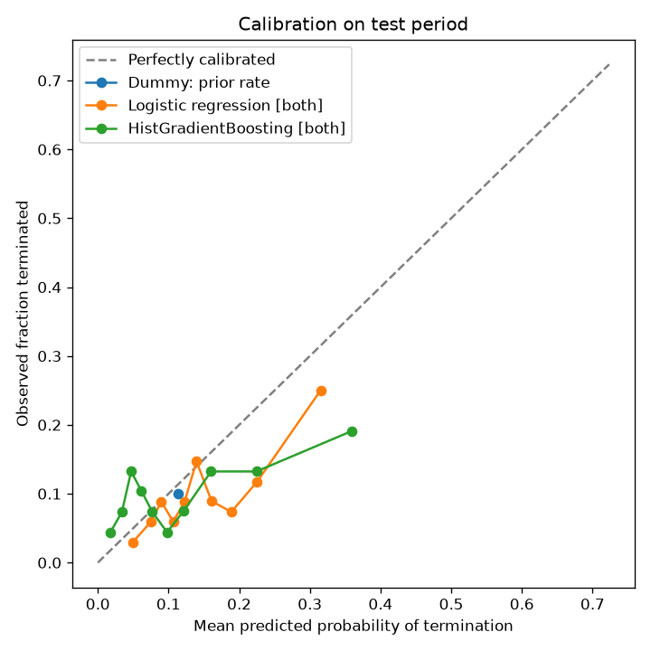

# Termination model results

Generated by `python -m ctcopilot.train` on 2026-10-20 from `data/trials.duckdb`. All numbers below come from that run.

## Data

- Studies in table: 6124
- Labelled (TERMINATED or COMPLETED): 4548
- Dropped for missing start_date: 30
- Used: 4518
- Validation starts at start_date >= 2015-10-01; test starts at start_date >= 2019-09-30

| Split | start_date range | n | terminated | terminated rate |
|---|---|---|---|---|
| train | 1972-01-01 to 2015-09-30 | 3153 | 354 | 0.112 |
| val | 2015-10-01 to 2019-09-24 | 687 | 84 | 0.122 |
| test | 2019-09-30 to 2026-06-12 | 678 | 68 | 0.100 |

## Test-period results

Models refit on train + validation with the hyperparameters that had the best validation PR AUC. Intervals are 95% percentile bootstrap over test studies (1000 resamples).

| Model | ROC AUC (95% CI) | PR AUC (95% CI) | Brier (95% CI) | Val PR AUC | Params |
|---|---|---|---|---|---|
| Dummy: majority class | 0.500 (0.500-0.500) | 0.100 (0.078-0.124) | 0.100 (0.078-0.124) | - | {'strategy': 'most_frequent'} |
| Dummy: prior rate | 0.500 (0.500-0.500) | 0.100 (0.078-0.124) | 0.090 (0.073-0.109) | - | {'strategy': 'prior'} |
| Logistic regression [both] | 0.634 (0.564-0.703) | 0.202 (0.136-0.299) | 0.091 (0.076-0.106) | 0.165 | {'C': 1.0} |
| HistGradientBoosting [both] | 0.598 (0.528-0.673) | 0.154 (0.110-0.230) | 0.094 (0.077-0.112) | 0.170 | {'learning_rate': 0.03, 'max_depth': None} |

## Ablation: feature blocks (test period)

| Model | ROC AUC (95% CI) | PR AUC (95% CI) | Brier (95% CI) | Val PR AUC | Params |
|---|---|---|---|---|---|
| Logistic regression [structured] | 0.499 (0.431-0.572) | 0.111 (0.084-0.168) | 0.092 (0.076-0.110) | 0.133 | {'C': 1.0} |
| HistGradientBoosting [structured] | 0.465 (0.400-0.534) | 0.092 (0.071-0.123) | 0.105 (0.088-0.123) | 0.155 | {'learning_rate': 0.03, 'max_depth': None} |
| Logistic regression [text] | 0.653 (0.585-0.718) | 0.214 (0.146-0.311) | 0.090 (0.073-0.109) | 0.199 | {'C': 0.01} |
| HistGradientBoosting [text] | 0.589 (0.521-0.658) | 0.132 (0.100-0.196) | 0.102 (0.082-0.123) | 0.189 | {'learning_rate': 0.1, 'max_depth': None} |
| Logistic regression [both] | 0.634 (0.564-0.703) | 0.202 (0.136-0.299) | 0.091 (0.076-0.106) | 0.165 | {'C': 1.0} |
| HistGradientBoosting [both] | 0.598 (0.528-0.673) | 0.154 (0.110-0.230) | 0.094 (0.077-0.112) | 0.170 | {'learning_rate': 0.03, 'max_depth': None} |

## Test-period results by phase

Metrics shown only where a group has at least 5 studies of each class; small groups have wide uncertainty.

| Group | n | terminated | Logistic regression [both] ROC AUC | Logistic regression [both] PR AUC | HistGradientBoosting [both] ROC AUC | HistGradientBoosting [both] PR AUC |
|---|---|---|---|---|---|---|
| PHASE1/PHASE2 | 55 | 9 | 0.519 | 0.203 | 0.420 | 0.270 |
| PHASE2 | 336 | 40 | 0.604 | 0.196 | 0.584 | 0.175 |
| PHASE2/PHASE3 | 35 | 3 | - | - | - | - |
| PHASE3 | 252 | 16 | 0.676 | 0.277 | 0.618 | 0.130 |

## Test-period results by sponsor class

| Group | n | terminated | Logistic regression [both] ROC AUC | Logistic regression [both] PR AUC | HistGradientBoosting [both] ROC AUC | HistGradientBoosting [both] PR AUC |
|---|---|---|---|---|---|---|
| FED | 3 | 0 | - | - | - | - |
| INDUSTRY | 442 | 40 | 0.628 | 0.228 | 0.616 | 0.152 |
| NIH | 5 | 2 | - | - | - | - |
| OTHER | 218 | 26 | 0.629 | 0.204 | 0.551 | 0.217 |
| OTHER_GOV | 10 | 0 | - | - | - | - |

## Text terms in Logistic regression [text]

Terms with the largest coefficients in the final (train + validation) model.

- Towards termination: tak, rimonabant, inhaled, tesaglitazar, diabetic, week, inhaled insulin, period, follow, period week, foot, ulcers, gallant, safety, treating, cp, determine, blind, follow period, extension
- Towards completion: insulin, glargine, insulin glargine, aim, control, glucose, type diabetes, intervention, vildagliptin, compare, aim trial, investigate, evaluate efficacy, conducted, liraglutide, exenatide, patients type, insulin degludec, degludec, based

## Calibration

